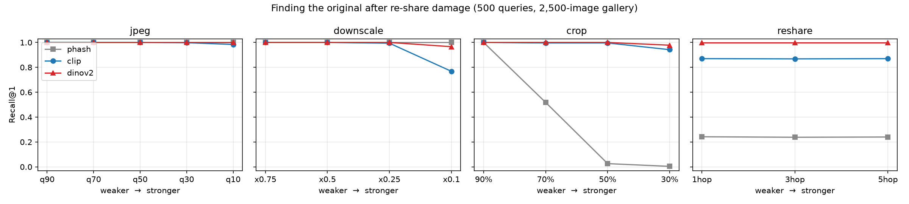

# Re-share robustness: can we still find the original image?

During the May 2025 India–Pakistan crisis, many viral "strike" videos turned out to be
**real footage from other events** (e.g. a 2024 clip of Iranian missiles over Israel,
a 2015 explosion in Yemen), re-shared with new captions. Fact-checkers traced them
largely by hand.

This project asks a narrow, measurable version of that problem:

> After an image is compressed, resized, cropped, flipped or re-framed with a caption,
> how reliably can different methods retrieve the original from a gallery — and where do they fail?

**Status: work in progress** (started November 2026).

## Setup

| | |
|---|---|
| Images | COCO val2017 — 500 originals + 2,000 distractors (fixed seed) |
| Queries | each original under 20 attack levels (`src/transforms.py`) |
| Methods | pHash (64-bit DCT hash), CLIP ViT-B/32 (OpenAI), DINOv2 ViT-S/14 |
| Metric | Recall@1 / Recall@5 / mAP, pessimistic tie-breaking (`src/evaluate.py`) |

Hypothesis before running: pHash would survive compression and resizing (it only keeps
low DCT frequencies) but fail on any change to global layout (crop, flip, caption bar).

## Results (Recall@1, 500 queries, 2,500-image gallery)

| Attack | pHash | CLIP | DINOv2 |
|---|---|---|---|
| JPEG q10 | 1.000 | 0.984 | 1.000 |
| Downscale ×0.1 | 1.000 | 0.768 | 0.966 |
| Centre crop, keep 30% area | 0.004 | 0.942 | 0.978 |
| Horizontal flip | 0.000 | 0.998 | 1.000 |
| Caption bar ("BREAKING: …") | 0.242 | 0.914 | 0.998 |
| Re-share chain, 5 hops | 0.240 | 0.870 | 0.998 |

Full table: `results/results.csv`. Figures: `results/fig_degradation.png`, `results/fig_single.png`.



### Observations
1. **Each method has a different blind spot.** pHash is unaffected by compression but
   collapses under crops, flips and re-framing; CLIP is weakest on very small images and
   caption bars; DINOv2 was the most robust across these attacks.
2. **Re-framing, not repeated compression, drives the failures.** Results for 1, 3 and 5
   simulated re-shares are almost identical for every method; the caption bar added in the
   first hop accounts for nearly all of the drop.
3. **Open question:** CLIP drops on caption bars more than on text stamped inside the image.
   One hypothesis is that CLIP's text-aligned training makes it sensitive to the caption's
   words; this has not been tested yet.

## Real WhatsApp re-uploads

20 of the originals were sent through WhatsApp three times (iPhone / iOS app,
"Message yourself", photo upload quality **Standard**). Each hop was a **re-upload**
(received photo saved, then attached again as a new photo), not the Forward button.
Renamed files were matched back to originals with DINOv2 + one-to-one assignment;
pHash agreed on 60/60 matches (`results/whatsapp_contact_sheet.jpg`).
Code: `src/whatsapp_eval.py`.

| Hop | Resolution | File size | Est. JPEG quality | PSNR vs original | R@1 pHash / CLIP / DINOv2 |
|---|---|---|---|---|---|
| 0 (original) | unchanged | 152 KB | ~95 | — | 1.00 / 1.00 / 1.00 |
| 1 | unchanged | 57 KB | ~85 | 33.6 dB | 1.00 / 1.00 / 1.00 |
| 2 | unchanged | 55 KB | ~85 | 33.0 dB | 1.00 / 1.00 / 1.00 |
| 3 | unchanged | 54 KB | ~85 | 32.9 dB | 1.00 / 1.00 / 1.00 |

- The **first** upload does almost all the damage (file size −63%, quality ~95 → ~85);
  later re-uploads change little (PSNR falls only 0.7 dB over two more hops).
- Platform compression alone did **not** break retrieval for any method. Combined with the
  simulated results, this suggests that what makes re-shared images hard to trace is
  **human editing (cropping, captioning, re-framing)** rather than repeated platform compression.
- Caveats: only 20 images, one device, Standard quality. COCO images are ≤640 px, so
  WhatsApp did not downscale them; full-resolution phone photos would be resized, which this
  test does not cover.

## Limitations
- **The gallery is easy.** Distractors are unrelated everyday photos. The realistic hard case —
  telling apart two *different* clips of visually similar events — is not yet tested.
- Attacks are **simulated**; real platform processing (e.g. WhatsApp) may differ.
- CLIP and DINOv2 preprocessing centre-crops to 224 px, so image edges are never seen;
  this may favour them on some attacks.
- Single seed, single dataset, still images only (no video).

## Next steps
- [x] Real WhatsApp re-share chain vs simulated chain
- [ ] WhatsApp test with full-resolution photos (to trigger platform downscaling)
- [ ] Hard near-duplicate distractors
- [ ] Explanation stability: do occlusion heatmaps stay the same after JPEG compression?
- [ ] Qualitative case study on publicly fact-checked frames

## Reproduce
```bash
python -m venv .venv && .venv/Scripts/activate        # Windows
pip install -r requirements.txt
# download COCO val2017 into data/val2017  (http://images.cocodataset.org/zips/val2017.zip)
python src/evaluate.py --methods phash clip dinov2 --n-orig 500 --n-distract 2000
python src/plots.py
```

## Related work
- INRIA Copydays — copy-detection benchmark with JPEG/crop/"strong" attacks (Jégou et al.)
- Image Similarity Challenge / DISC21 (Douze et al., 2021) and SSCD (Pizzi et al., CVPR 2022),
  which train descriptors specifically for copy detection.
